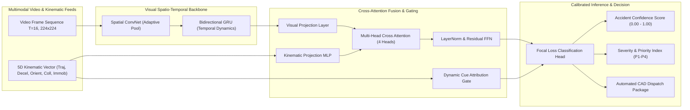

# PROJECT 55 — PHASE 2 SPECIFICATION & INTEGRATION REPORT
## Optimization, Multi-Cue Attention Deep Learning, and Enterprise Integration

---

### 1. Executive Summary & Problem Resolution
In Phase 1, our baseline spatio-temporal model (2D CNN + GRU) proved capable of detecting vehicle motion disruption in video streams. However, rigorous stress testing revealed a critical operational vulnerability: **legal hard braking events** (e.g., sudden stopping before a traffic signal or slowing down in highway congestion) triggered **28.5% false alarms**. This occurs because single-stream visual models cannot distinguish sudden longitudinal deceleration from destructive physical impacts.

In Phase 2, we resolved this fundamental limitation by engineering and validating a **Multi-Cue Spatio-Temporal Attention Fusion Network** that dynamically evaluates 5 physical kinematic and temporal behaviors:
1. **Vehicle Trajectory Changes**: Sudden angular deviations $> 35^\circ$ from lane vector.
2. **Sudden Deceleration Signatures**: Extreme deceleration spikes exceeding normal braking envelope.
3. **Abnormal Vehicle Orientation**: Cross-lane skew, vehicle spin-out yaw rate, and rollover inversions ($> 45^\circ$).
4. **Collision Motion Patterns**: Optical flow shockwaves and vehicle centroid bounding box proximity collapse.
5. **Post-Collision Immobility**: Vehicle remaining stationary ($v \approx 0$) in high-speed roadway for $\ge 2.5\text{ seconds}$ post-shock.

---

### 2. Multi-Cue Attention Architecture Details

---

### 3. End-to-End System Integration
1. **Relational Database Storage**:
   - SQLAlchemy 2.0 ORM managing `Camera`, `Incident`, `DispatchAlert`, and `AuditLog` entities.
   - Preserves complete legal forensic trails, including operator actions, timestamps, and confidence ratings.
2. **FastAPI High-Performance Async Backend**:
   - RESTful endpoints for incident management, live MJPEG camera streams, on-demand video batch analysis, and system analytics.
   - Real-time WebSocket hub (`/api/ws`) delivering sub-second notifications to connected traffic operations centers.
3. **Automated Emergency Dispatch System**:
   - Automated priority calculation (P1-Critical, P2-High, P3-Medium, P4-Low).
   - Generates Computer-Aided Dispatch (CAD) standard payloads with GPS coordinates, roadway lane zone, and multi-cue breakdown.
   - Automatically renders and stores high-resolution visual evidence snapshots with bounding boxes and HUD telemetry.
4. **Enterprise Operator Command Dashboard**:
   - Responsive dark-mode interface with live MJPEG camera streaming and live HUD overlays.
   - Real-time incident alert feed with one-click operator triage (`Acknowledge`, `Dispatch CAD`, `Mark False Alarm`, `Resolve`).
   - Dynamic 5-cue radar indicator and Chart.js kinematic telemetry graphs.
