# Crop Yield Prediction — A Machine Learning Decision Support System

**Supervised Regression & Classification on FAO Agricultural Data**

Your Name — Student ID
Course / Module Name
Supervisor: Supervisor Name
Institution Name — June 2026

---

## Table of Contents

1. [Introduction](#1-introduction)
2. [Dataset](#2-dataset)
3. [Exploratory Data Analysis](#3-exploratory-data-analysis)
4. [Data Preprocessing](#4-data-preprocessing)
5. [Regression Models and Results](#5-regression-models-and-results)
6. [Classification Models and Results](#6-classification-models-and-results)
7. [The Application](#7-the-application)
8. [Conclusion](#8-conclusion)
9. [References](#references)

---

## 1. Introduction

Crop yield prediction is a key tool for food security, harvest planning, and the allocation of agricultural resources such as pesticides and irrigation. Estimating the expected yield of a crop *before* the growing season allows governments and farmers to anticipate production volumes, plan budgets, and manage risk under varying climate conditions.

This project addresses the prediction of crop yield, measured in hectograms per hectare (`hg/ha`), from climate and agricultural input data. Two supervised learning tasks are tackled:

- **Regression** — predict the exact continuous yield value.
- **Classification** — predict the yield *level*: a binary target (below / above average) and a three-class target (low / medium / high).

The objectives are to build, compare, and evaluate six regression models and four classifiers on a real-world dataset, and to deliver the result as an interactive web application. The remainder of this report covers the dataset (Section 2), exploratory data analysis (Section 3), preprocessing (Section 4), regression and classification results (Sections 5–6), the application (Section 7), and conclusions (Section 8).

---

## 2. Dataset

The data is built from four independent FAO and climate sources — crop yield, pesticide use, annual rainfall, and average temperature — each keyed by country and year. These are merged on (country, year) into a single, cleaned analysis file, `yield_df.csv`, which is the only file used by the models.

**Table 1 — Key properties of the merged dataset `yield_df.csv`.**

| Property | Value |
|---|---|
| Records | 28,242 |
| Countries (Area) | 101 |
| Crops (Item) | 10 |
| Year range | 1990 – 2013 |
| Missing values | 0 |

The dataset has six input columns and one target. After dropping a CSV index artefact, the structure is:

**Table 2 — Columns of the dataset. The target is the crop yield.**

| Column | Type | Description |
|---|---|---|
| `Area` | Categorical | Country (101 unique values) |
| `Item` | Categorical | Crop type (10 unique values) |
| `Year` | Numerical | Year of observation (1990–2013) |
| `average_rain_fall_mm_per_year` | Numerical | Annual rainfall (mm) |
| `pesticides_tonnes` | Numerical | Pesticide use (tonnes) |
| `avg_temp` | Numerical | Average temperature (°C) |
| `hg/ha_yield` | Numerical **(target)** | Crop yield (hg/ha) |

The target has a mean of ≈ 77,053 hg/ha but a median of only ≈ 38,295 hg/ha. This large gap is the first indication that the yield distribution is strongly right-skewed, which is confirmed in the next section.

---

## 3. Exploratory Data Analysis

Before modelling, the distributions of the target and features and the relationships between them were explored.

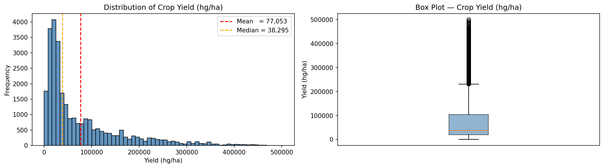
***Figure 1** — Distribution of crop yield (histogram and box plot). The distribution is heavily right-skewed: most records sit at low yields, with a long tail of high-yield crops.*

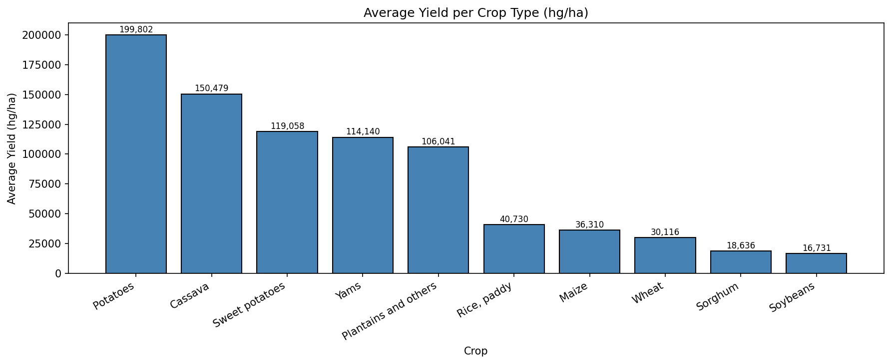
***Figure 2** — Average yield per crop. Root crops such as Cassava and Potatoes yield far more (hg/ha) than cereals such as Wheat and Sorghum, showing that the crop type is a major driver of yield.*

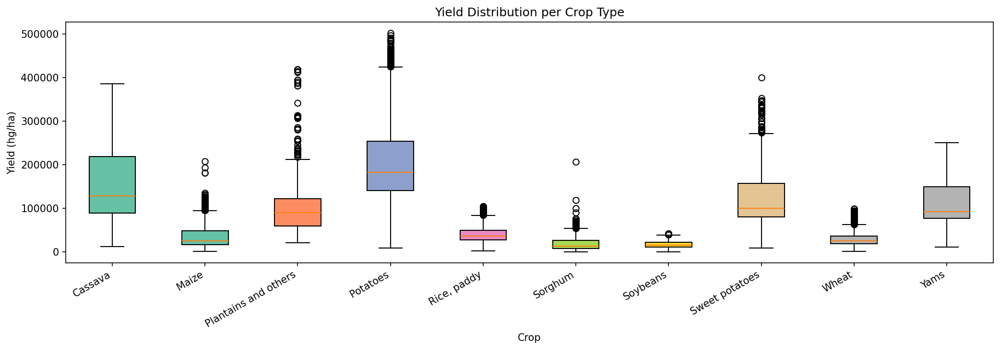
***Figure 3** — Yield distribution per crop (box plots), confirming both the between-crop differences and the within-crop spread.*

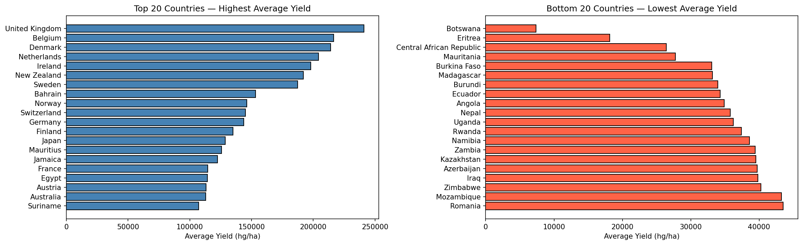
***Figure 4** — Top 20 countries by average yield. High-yield countries are concentrated in regions with intensive agriculture.*

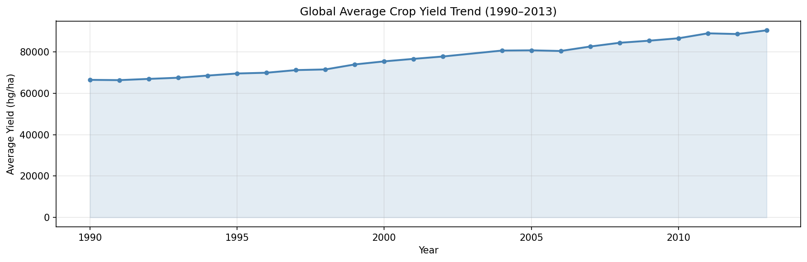
***Figure 5** — Global average yield trend over time (1990–2013), showing a gradual upward trend.*

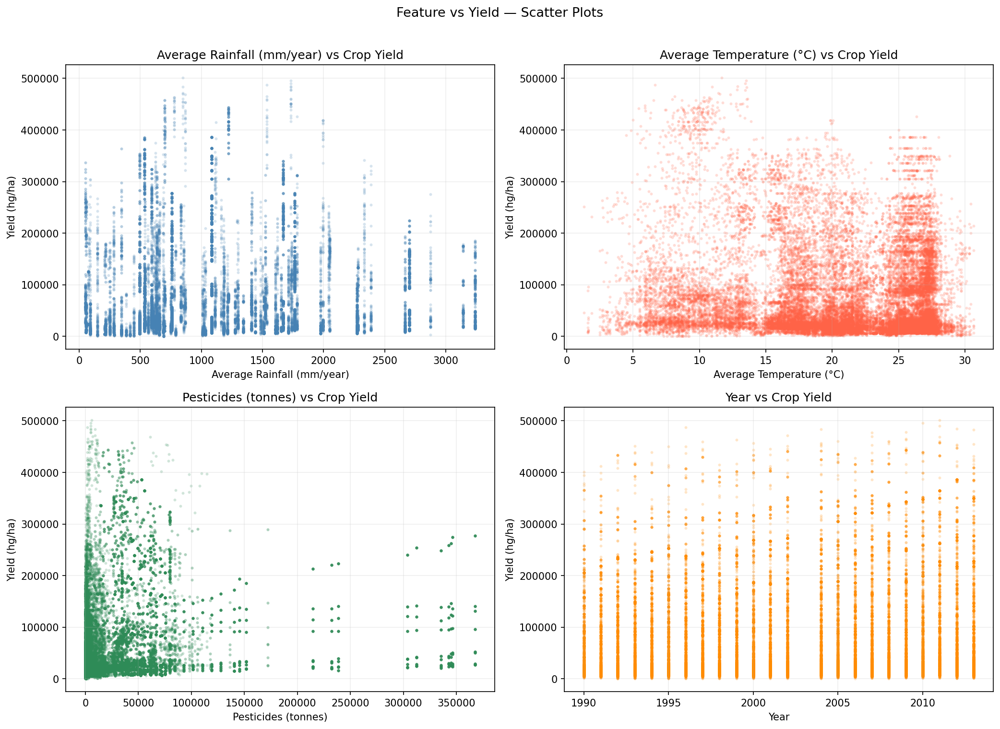
***Figure 6** — Scatter plots of each numerical feature against yield. The relationships are weak and non-linear, suggesting that linear models alone will be insufficient.*

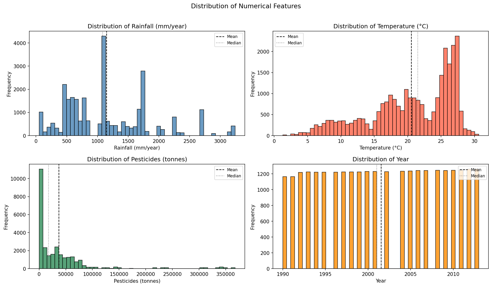
***Figure 7** — Distributions of the four numerical features.*

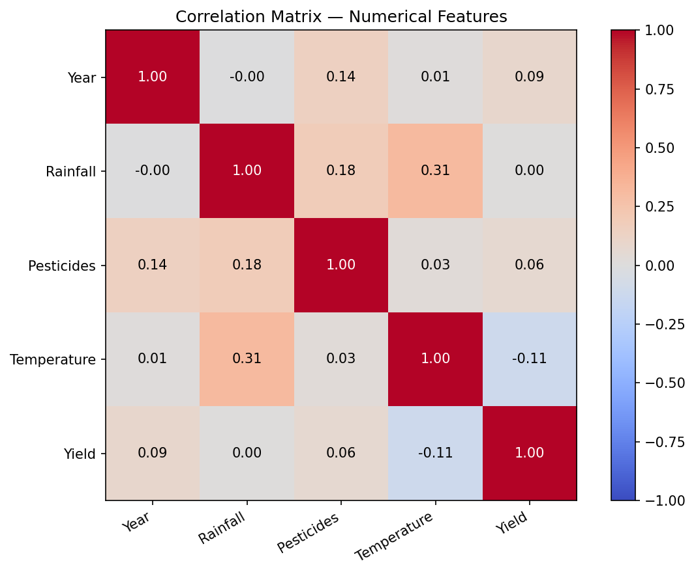
***Figure 8** — Correlation between the numerical features and yield. The numerical features are only weakly correlated with the target (temperature −0.11, pesticides +0.06, rainfall ≈ 0).*

**Key observations:**

- The yield distribution is strongly right-skewed.
- Crop type (and country) explain far more of the variance than the numerical climate features, whose linear correlation with yield is weak.
- There are no missing values, so no imputation is required.
- The weak, non-linear numeric relationships indicate that non-linear ensemble models should outperform linear ones.

---

## 4. Data Preprocessing

The same preprocessing pipeline is used for both tasks:

1. **Drop the index column** and split the six input columns from the target `hg/ha_yield`.
2. **One-hot encode** the two categorical columns: `Area` (101 countries) and `Item` (10 crops), producing 111 binary columns.
3. Keep the four numerical columns unchanged, giving a total of **115 model features**.
4. **Scale** only the four numerical columns with a `StandardScaler`, fit on the *training set only* to prevent data leakage. The 111 binary columns are left as-is.
5. **Split** into train/test: 80/20 for regression and 75/25 for classification (`random_state=0`).

The feature expansion is the central preprocessing step:

```
Area (101) + Item (10) = 111 one-hot columns + 4 numeric columns = 115 features
```

The six original columns therefore become 115 features fed into every model. For polynomial regression, `PolynomialFeatures` is applied only to the four numerical columns (to avoid an explosion from the 111 binary columns) and then concatenated back with the one-hot columns.

---

## 5. Regression Models and Results

Six regression models were trained, plus a naive mean-predictor baseline: Linear Regression, Polynomial Regression (degrees 2 and 3), Decision Tree, Random Forest, Gradient Boosting, and Support Vector Regression (SVR, RBF kernel).

**Table 3 — Regression benchmark on the held-out test set. Random Forest is the best model; SVR performs worse than the baseline.**

| Model | R² | MAE | RMSE |
|---|---|---|---|
| **Random Forest** | **0.9888** | 3,494 | 9,143 |
| Decision Tree | 0.9823 | 3,607 | 11,508 |
| Gradient Boosting | 0.8718 | 19,912 | 30,952 |
| Polynomial (deg=3) | 0.7600 | 29,389 | 42,345 |
| Polynomial (deg=2) | 0.7598 | 29,369 | 42,364 |
| Linear Regression | 0.7597 | 29,261 | 42,368 |
| Baseline (mean) | −0.0003 | 65,021 | 86,449 |
| SVR (RBF) | −0.2121 | 58,168 | 95,162 |

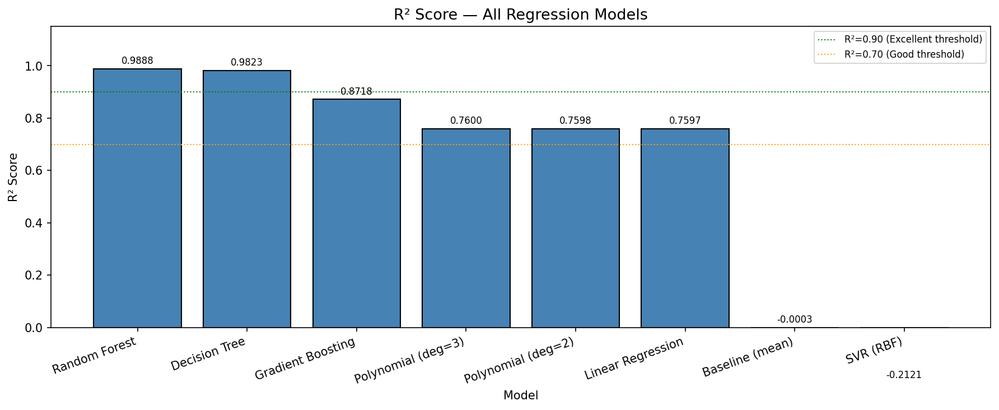
***Figure 9** — R² score by model (higher is better).*

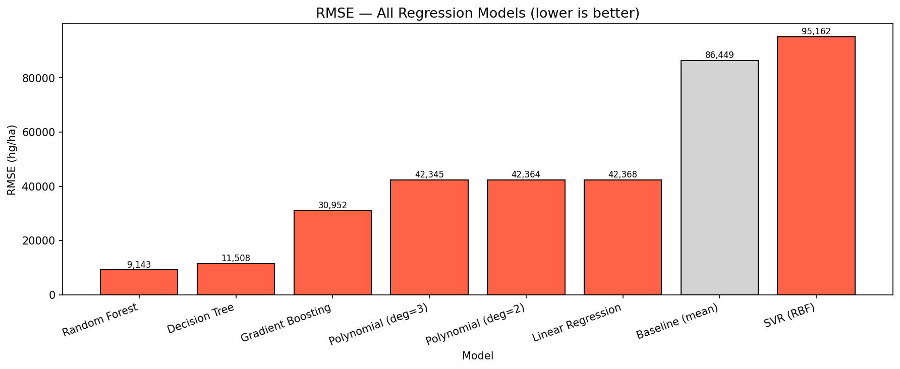
***Figure 10** — RMSE by model (lower is better). Ensemble tree models clearly dominate the linear and polynomial models.*

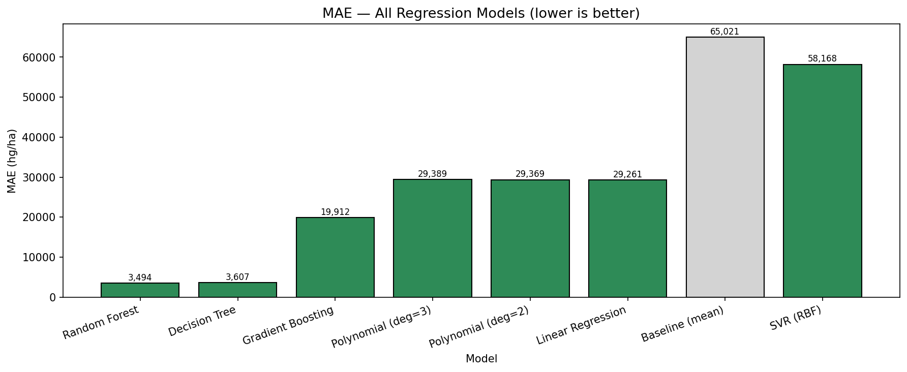
***Figure 11** — Mean Absolute Error (MAE) by model (lower is better).*

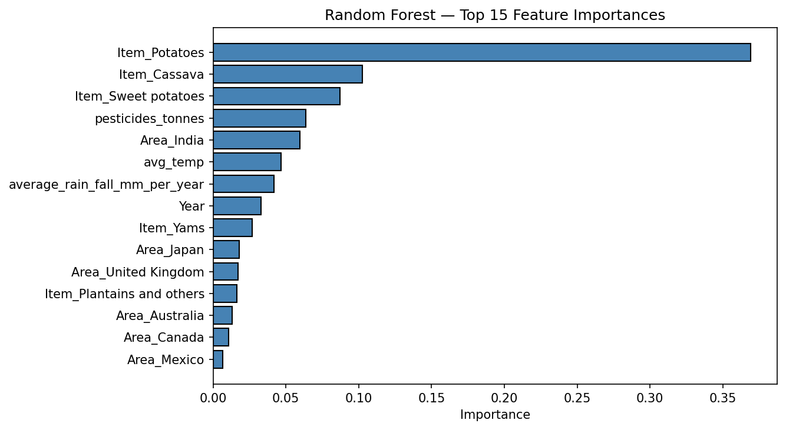
***Figure 12** — Random Forest feature importance (top 15). Pesticide use, year, and the climate features, together with a few dominant crop types, drive predictions.*

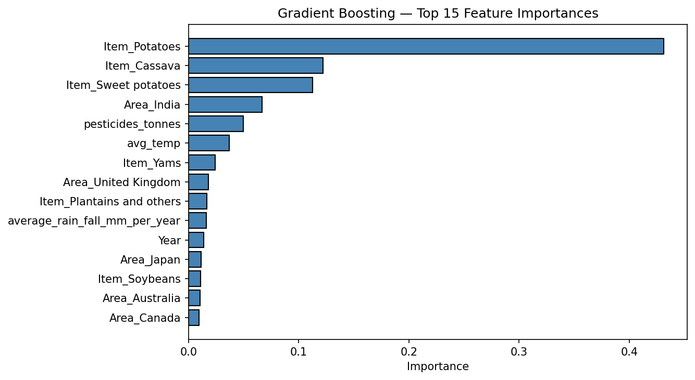
***Figure 13** — Gradient Boosting feature importance (top 15).*

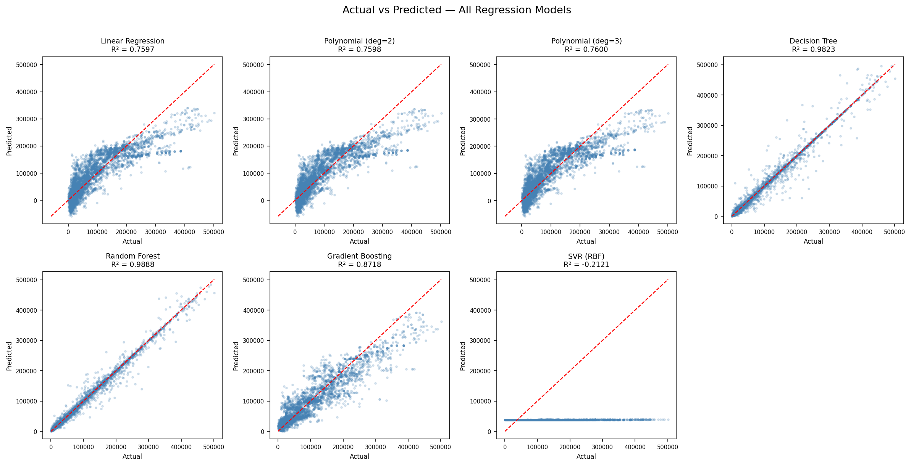
***Figure 14** — Actual vs. predicted yield for all models, side by side. The tighter the points cluster on the diagonal, the better the model.*

### Per-model actual-vs-predicted and residual plots


***Figure 15** — Linear Regression.*

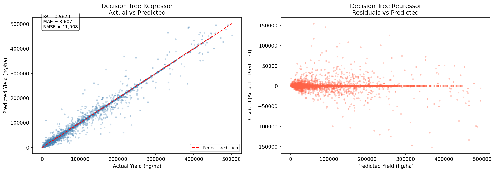
***Figure 16** — Decision Tree.*

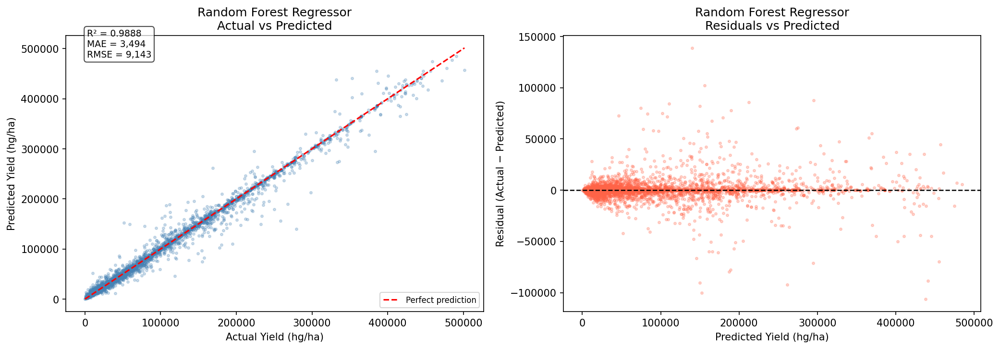
***Figure 17** — Random Forest (best model).*

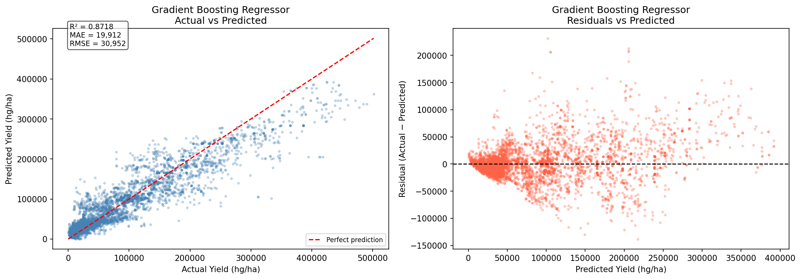
***Figure 18** — Gradient Boosting.*

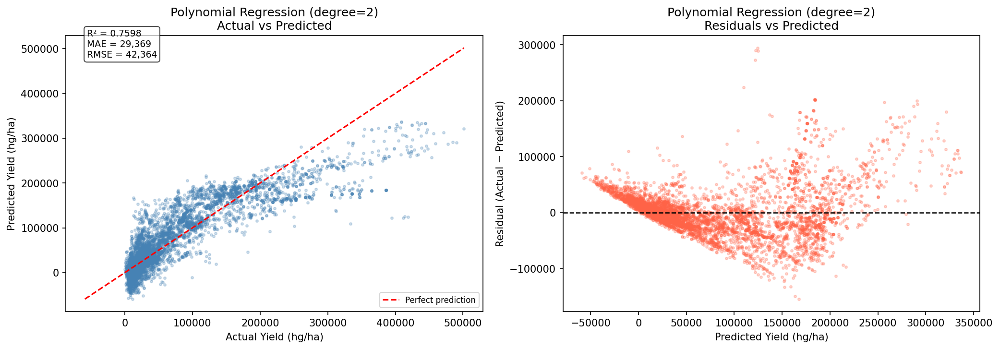
***Figure 19** — Polynomial Regression (degree 2).*


***Figure 20** — Polynomial Regression (degree 3).*

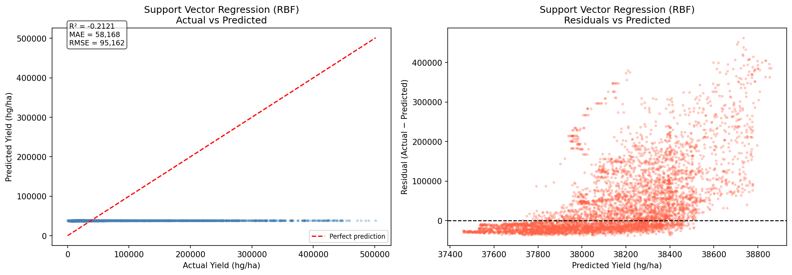
***Figure 21** — SVR (RBF) — worse than baseline.*

**Discussion.** The Random Forest explains **98.9%** of the variance in yield (R² = 0.9888) with a mean absolute error of only ≈ 3,494 hg/ha — a 94.6% reduction over the baseline. Linear and polynomial models plateau at R² ≈ 0.76, confirming the non-linear nature of the problem seen in the EDA. Notably, SVR with an RBF kernel performs *worse than the baseline* (R² = −0.21): the RBF kernel does not cope well with the sparse, high-dimensional one-hot encoded feature space.

---

## 6. Classification Models and Results

For classification, the continuous yield is discretised. The **binary** target splits records at the training mean (77,053 hg/ha) into below/above average. The **three-class** target uses the 33rd and 67th percentiles to form low/medium/high bands. Four classifiers were trained for each target: Random Forest, K-Nearest Neighbors (k=5), Logistic Regression, and Naive Bayes.

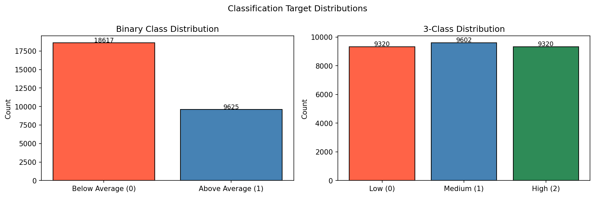
***Figure 22** — Class balance for the binary and three-class targets.*

### Binary classification

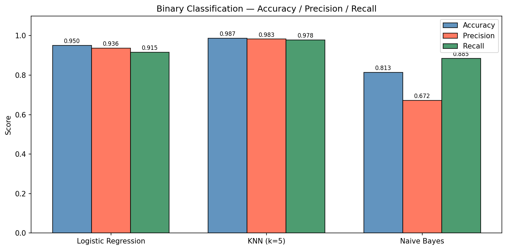
***Figure 23** — Binary classification — accuracy, precision, and recall per model. KNN achieves the best overall scores.*

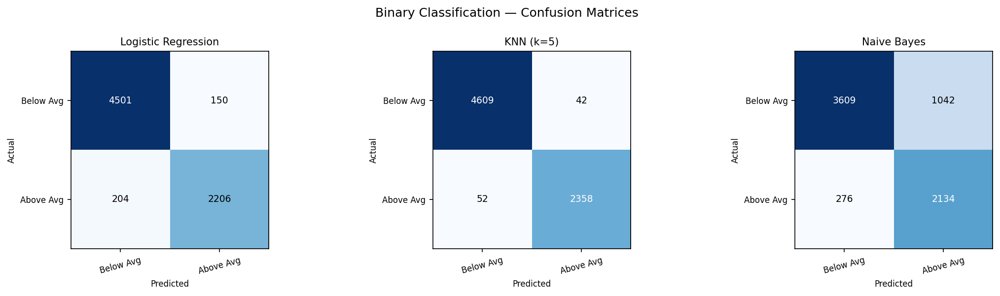
***Figure 24** — Confusion matrices for the binary classifiers (Logistic Regression, KNN, Naive Bayes).*

### Three-class classification

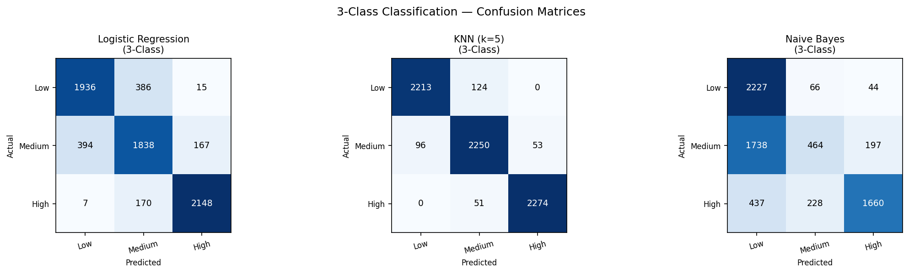
***Figure 25** — Confusion matrices for the three-class (low/medium/high) classifiers.*

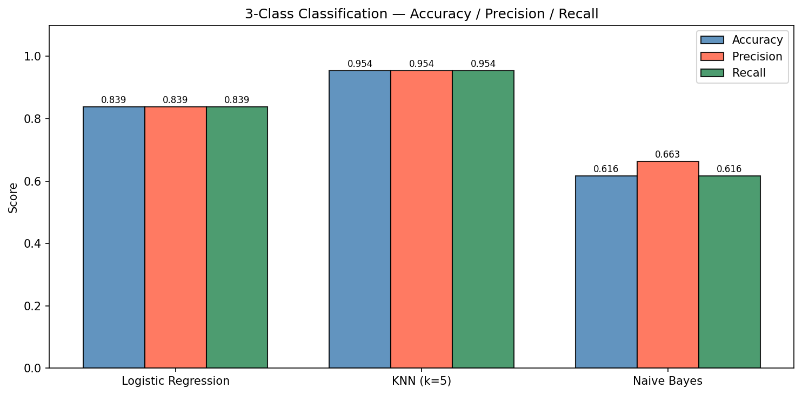
***Figure 26** — Three-class classification — accuracy, precision, and recall per model.*

**Table 4 — Best classifier per task (accuracy on the test set).**

| Task | Best model | Accuracy |
|---|---|---|
| Binary | K-Nearest Neighbors (k=5) | 0.987 |
| 3-class | K-Nearest Neighbors (k=5) | 0.954 |

**Discussion.** KNN is the strongest classifier on both targets (binary accuracy 0.987, three-class accuracy 0.954), narrowly ahead of the Random Forest classifier. Naive Bayes is the weakest (0.813 binary, 0.616 three-class) because its assumption of feature independence is violated by the one-hot encoded data. Interestingly, the best *classifier* (KNN) differs from the best *regressor* (Random Forest).

---

## 7. The Application

The project is delivered as an interactive web application (a Flask REST API serving a React frontend) that covers the full workflow: data exploration, model benchmarks, visualisations, and live prediction. The dashboard reports the real dataset statistics and recent predictions.


***Figure 27** — The CropAI web application dashboard, showing dataset key figures (28,242 records, 101 countries, 10 crops, 1990–2013), a prediction entry point, and recent predictions.*

---

## 8. Conclusion

This project built and compared a full suite of supervised models for crop yield prediction on a 28,242-row, 115-feature dataset. The **Random Forest** regressor is the best model for predicting exact yield (R² = 0.989), while **KNN** is the best classifier for predicting yield level (98.7% binary accuracy). The exploratory analysis and feature-importance results agree that categorical features (crop and country) carry most of the predictive signal, and that non-linear ensemble methods substantially outperform linear models and SVR.

**Limitations and future work:**

- The data ends in 2013 and covers only 10 crop types.
- The numerical climate features are only weakly correlated with yield; adding soil quality, fertiliser, and irrigation data could improve accuracy.
- Hyperparameter tuning and cross-validation could further refine the ensemble models.

---

## References

- FAO — Food and Agriculture Organization of the United Nations, crop, pesticide, and climate datasets.
- F. Pedregosa et al., *scikit-learn: Machine Learning in Python*, JMLR 12, 2011.
- The pandas, NumPy, Matplotlib, and Flask open-source libraries.
