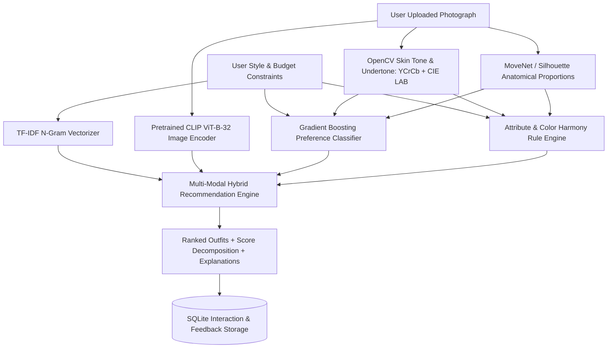

# Skin Tone Body Measurement Based Dress Recommendation

An AI-powered academic multi-modal fashion intelligence platform built with **Streamlit**, **Computer Vision (OpenCV CIE LAB + MoveNet)**, **Deep Learning (CLIP ViT-B-32 + OpenVINO)**, **Natural Language Processing (TF-IDF)**, and **Predictive Machine Learning (Gradient Boosting)**.

---

## 🌟 System Architecture & Pipeline



---

## 🛠️ Multi-Modal Hybrid Ensemble Formula

The recommendation engine combines 4 distinct signals:

$$\text{Final Score} = w_{\text{tfidf}} \cdot S_{\text{tfidf}} + w_{\text{clip}} \cdot S_{\text{clip}} + w_{\text{gbm}} \cdot S_{\text{gbm}} + w_{\text{attr}} \cdot S_{\text{attr}}$$

* **$S_{\text{tfidf}}$:** Lexical cosine similarity over metadata descriptions ($w_{\text{tfidf}} = 0.30$).
* **$S_{\text{clip}}$:** Pretrained visual embedding cosine similarity ($w_{\text{clip}} = 0.30$).
* **$S_{\text{gbm}}$:** Demographic category preference affinity probability ($w_{\text{gbm}} = 0.25$).
* **$S_{\text{attr}}$:** Rule-based color harmony & silhouette compatibility score ($w_{\text{attr}} = 0.15$).

*(Weights are dynamically renormalized if no reference photo is uploaded or if an acceleration backend is offline).*

---

## 📂 Project Structure

```
personalized_outfit_recommendation_system/
├── app.py                      # Multi-Section Streamlit UI
├── config.py                   # Central settings, paths, and default weights
├── requirements.txt            # Dependency specifications
├── haarcascade_frontalface_default.xml # Haar Cascade face detector
├── data/
│   ├── raw/                    # Raw imported assets
│   ├── processed/              # Processed catalog & training CSVs
│   ├── synthetic/              # Synthetic demonstration catalog (1,000 items)
│   └── user_data.db            # Local SQLite database (privacy-preserving)
├── models/
│   ├── gbm_pipeline.joblib     # Fitted scikit-learn Gradient Boosting pipeline
│   ├── tfidf_vectorizer.joblib # Fitted TfidfVectorizer (n-grams 1, 2)
│   ├── tfidf_matrix.npz        # Sparse document matrix
│   └── clip_embeddings/        # Cached visual embeddings
├── src/
│   ├── data_loader.py          # Dataset generator & catalog manager
│   ├── data_validation.py      # Schema checks & image file validation
│   ├── train_gbm.py            # Leakage-safe GBM pipeline on stratified split
│   ├── text_recommender.py     # TF-IDF search & constraint filtering
│   ├── clip_recommender.py     # Pretrained CLIP visual feature extractor
│   ├── skin_analysis.py        # OpenCV CIE LAB & YCrCb skin tone analysis
│   ├── body_measurement.py     # MoveNet pose proportions & manual input
│   ├── attribute_rules.py      # Transparent color harmony & silhouette rules
│   ├── hybrid_recommender.py   # Multi-modal hybrid ensemble scoring
│   ├── evaluation.py           # Ablation experiments & metrics
│   └── feedback.py             # SQLite feedback & interaction tracking
├── scripts/
│   ├── prepare_dataset.py      # Prepares 1,000 synthetic records and validates schema
│   ├── train_models.py         # Trains GBM on 80/20 split and builds TF-IDF index
│   └── evaluate_models.py      # Runs comparative ablation experiments
├── tests/
│   ├── test_academic_suite.py  # 8 academic test cases (pytest & unittest)
│   └── test_all.py             # Unit and integration test suite
└── reports/
    ├── gbm_evaluation.json     # Test split accuracy, macro-F1, confusion matrix
    └── experiment_comparison.csv # Ablation comparison across recommendation variants
```

---

## 🚀 Execution & Demonstration Commands

### 1. Environment Setup
```bash
python -m venv .venv
# Windows:
.venv\Scripts\activate
# Linux/macOS:
source .venv/bin/activate
pip install -r requirements.txt
```

### 2. Dataset Preparation
```bash
python scripts/prepare_dataset.py
```

### 3. Model Training & Indexing
```bash
python scripts/train_models.py
```

### 4. Offline Model Evaluation & Experiments
```bash
python scripts/evaluate_models.py
```

### 5. Run Automated Tests
```bash
python -m pytest tests/test_academic_suite.py
```

### 6. Launch Application
```bash
streamlit run app.py
```
Open **http://localhost:8501** in your browser.

---

## ⚖️ Ethical Considerations & Limitations
* **Styling Guidance Only:** Skin tone and body measurements are used solely for optional aesthetic styling guidance (color harmony and silhouette balance) and never to rank beauty or personal worth.
* **Camera Illumination:** Skin tone measurements via YCrCb and CIE LAB are approximate optical estimations subject to ambient lighting and white balance.
* **Proportion Ratios:** MoveNet anatomical landmarks evaluate visual ratios, not certified centimeter tape measurements. Manual override is always provided.
* **Privacy:** Uploaded images are processed in memory and never stored in the database.
