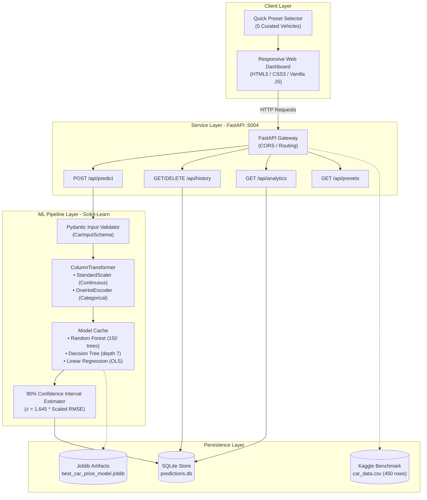

# System Architecture & Technical Design

## Architectural Overview

AutoValuate AI is structured as a decoupled multi-layer system separating model training, preprocessing pipelines, transactional persistence, REST microservices, and interactive web presentation.

## Layer Specifications

### 1. Client Presentation Layer
- Built with standard HTML5, modern CSS3 variables, and Vanilla JavaScript with zero external CDN dependencies.
- Features six dedicated tabs: Valuation Engine, Model Benchmarks, Feature Importance, Prediction History, Dataset Explorer, and REST API Documentation.
- Renders dynamic 10-year value depreciation bars using pure CSS calculations.

### 2. FastAPI Microservice Gateway (Port 5004)
- High-concurrency asynchronous ASGI server running via Uvicorn.
- Strict Pydantic input schema validation preventing invalid vehicle parameters (negative prices, future manufacturing years, exorbitant mileage).

### 3. Machine Learning Regression Pipeline
- Encapsulated within `sklearn.pipeline.Pipeline`.
- Transforms raw multi-modal tabular data (continuous numbers and categorical strings) into a 22-dimensional feature tensor.
- Returns fair market valuations, confidence bounds, depreciation percentages, and value retention ratings.

### 4. Database Layer
- SQLite database (`source_code/data/predictions.db`) maintaining the `prediction_history` table for historical auditability and analytics.
