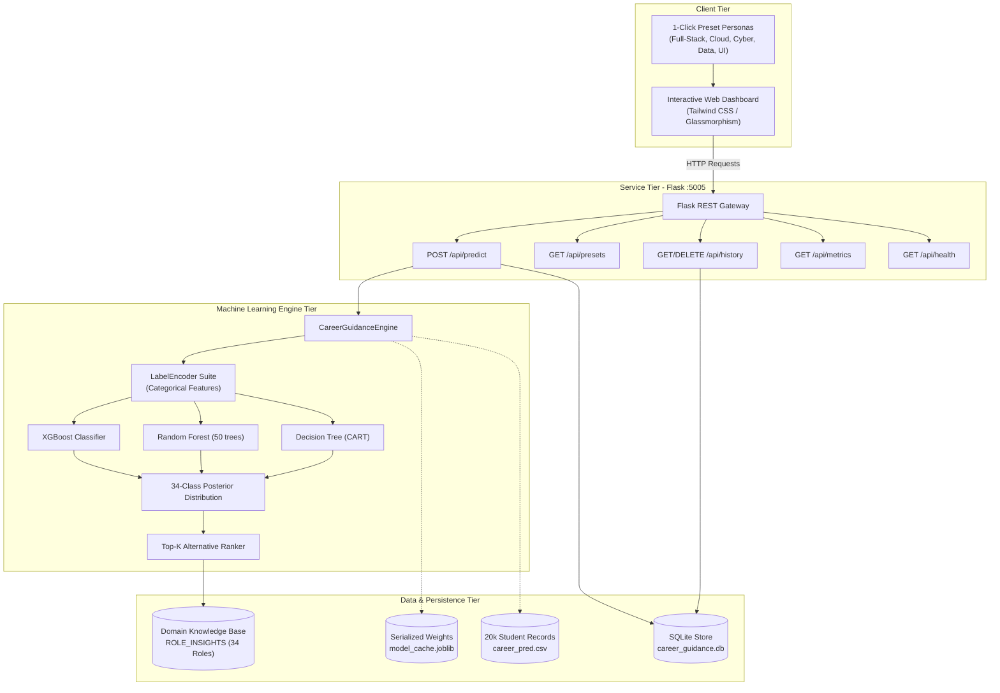

# System Architecture & Technical Design

## Architectural Overview

Career Guidance AI is designed as a decoupled multi-tier architecture connecting an interactive frontend, Flask REST microservice, machine learning engine, domain knowledge base, and SQLite audit store.

## Architectural Highlights

1. **In-Memory Model Caching**:
   Serialized models, encoders, and metrics are bundled in `model_cache.joblib`, enabling cold-start inference within 30ms.

2. **Multi-Model Support**:
   Users can toggle between XGBoost, Random Forest, and Decision Tree via REST payload parameters (`model_name`).

3. **Fallback & Knowledge Augmentation**:
   Classifier outputs are mapped to `ROLE_INSIGHTS`, adding rich actionable metadata (certifications, salary, skills).
