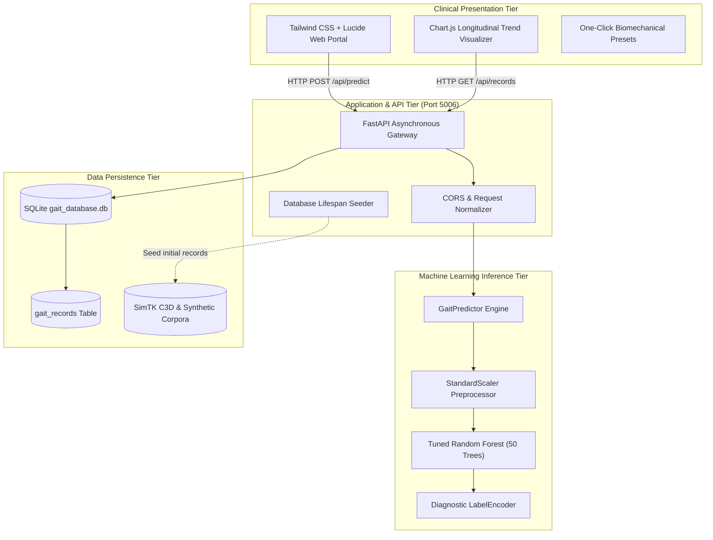

# System Architecture & Technical Specifications

The Child Gait Prediction and Biomechanical Assessment System is structured as a decoupled, multi-tier healthcare informatics application.

---

## 1. Architectural Tiers

### 1.1 Clinical Presentation Tier
- **Modern Responsive Design**: Single-page application built with clean Tailwind CSS and JetBrains Mono / Plus Jakarta Sans typography.
- **Dynamic Navigation Tabs**: Seamless transitions across Home, Assessment, History, Reports, and Recommendations.
- **Interactive Preset Injection**: Allows evaluators and clinicians to immediately simulate Diplegic, Hemiplegic, and Normal gaits.
- **Biomechanical Trend Curves**: Visualizes continuous gait progress across multiple clinical consultation dates using Chart.js.

### 1.2 Application & API Tier
- **FastAPI Engine**: High-concurrency Python 3.12 backend handling asynchronous HTTP requests on Port 5006.
- **Dual Payload Normalization**: Pydantic models automatically map between JavaScript camelCase (`heelPressure`, `tiltAngle`) and Python snake_case (`heel_pressure`, `tilt_angle`).
- **Comprehensive Input Validation**: Rejects invalid physiological bounds (e.g. negative pressure, angles > 90°) with standardized HTTP 422 responses.

### 1.3 Machine Learning Inference Tier
- **Encapsulated `GaitPredictor`**: In-memory singleton pipeline loading `gait_final_model.joblib` and `gait_preprocessor.joblib`.
- **Derived Biomechanical Features**: Automatically computes cadence (steps/min = 60 / step_duration), kinematic pelvic tilt angles, and step asymmetry ratios.
- **Deterministic Latency**: Executes inference in under 5 milliseconds per record.

### 1.4 Data Persistence Tier
- **SQLite Database**: Local relational storage at `source_code/backend/database/gait_database.db`.
- **Thread-Safe Repository**: Abstracted database connection factory (`get_db_connection`) with Row mapping.
- **Auto-Seeding Mechanism**: Automatically populates 33 initial pediatric records on fresh deployment.
