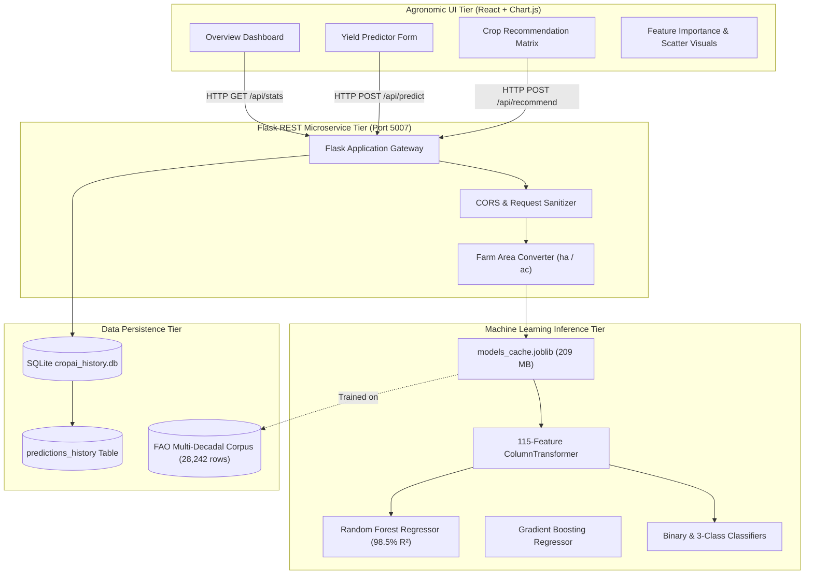

# System Architecture & Technical Specifications

CropAI is engineered as a decoupled full-stack machine learning web application running on Port 5007.

---

## 1. Architectural Tiers

### 1.1 Presentation Tier
- **React 18 Single-Page Application**: Componentized modular views (`dashboard.jsx`, `predictions.jsx`, `exploration.jsx`, `visualizations.jsx`, `about.jsx`).
- **Interactive Climate Sliders**: Real-time slider-input bindings for Rainfall (0–3,500 mm), Temperature (0–40°C), and Pesticides (0–50,000 Tonnes).
- **Responsive Charting**: Chart.js graphs displaying feature importance hierarchies, scatter distributions, and historical trends.

### 1.2 REST Gateway Tier
- **Flask Framework**: Lightweight microservice handling HTTP requests on Port 5007.
- **Input Validation**: Strict physiological and agronomic range checking (rejection of negative rainfall, temperature anomalies > 60°C).
- **Farm Area Engine**: Bidirectional unit conversion between Hectares and Acres, computing total harvest tonnages and kilograms.

### 1.3 Machine Learning Inference Tier
- **Serialized Model Bundle**: Fast deserialization of pre-trained models via Joblib (`source_code/models_cache.joblib`, 209 MB).
- **ColumnTransformer**: Transposes 101 countries and 10 staple crops into 115 continuous/one-hot dimensions.
- **Low-Latency Prediction**: Sub-10 millisecond inference across single queries and batch recommendation sweeps.

### 1.4 Data Persistence Tier
- **SQLite Database**: Local relational storage at `source_code/cropai_history.db`.
- **Query Logging**: Audits all predictions with user scenario metadata, predicted yields, and timestamps.
