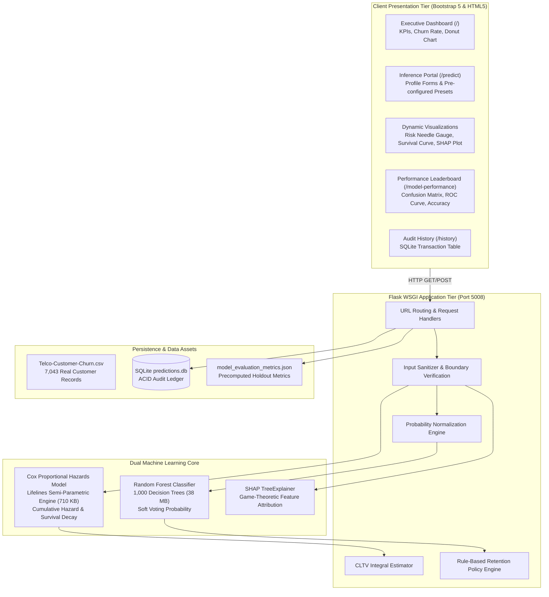

# System Architecture & Technical Design: Customer Churn Prediction (PROJECT-008)

## 1. High-Level Architectural Overview
PROJECT-008 is structured as an enterprise-grade, multi-tier intelligence application designed to predict telecom subscriber churn, model time-to-event survival hazard curves, compute customer lifetime value (CLTV), and deliver local explainability via SHAP.

## 2. Component Design Specifications

### 2.1 Microservice Controller (`app.py`)
- **Port Allocation**: 5008 (`http://127.0.0.1:5008`)
- **Framework**: Flask 3.0+ WSGI application with Jinja2 templating.
- **Backward Compatibility Shims**: Custom `_CustomUnpickler` and `_PatchedTree` dynamically resolve scikit-learn tree node state differences across minor library releases.
- **REST APIs**: JSON endpoints (`/api/stats`, `/api/metrics`, `/api/history`) support programmatic consumption by third-party CRMs.

### 2.2 Dual Machine Learning Inference Pipeline
- **Binary Classification (Random Forest)**:
  - 1,000 estimators with balanced class weighting.
  - Takes 23 input features (demographics, services, contracts, charges, and tenure).
  - Encapsulated with a probability normalization wrapper ensuring $\sum P(Y) = 1.0$.
- **Time-to-Event Survival Analysis (Cox Proportional Hazards)**:
  - Evaluates hazard multiplier $h(t|X) = h_0(t) \exp(\beta^T X)$.
  - Takes 22 features (excluding tenure duration $T$).
  - Outputs continuous survival probability curve $S(t)$ over 72 months.
- **Local Interpretability (SHAP TreeExplainer)**:
  - Decomposes exact Shapley feature values $\phi_i$ for each customer query.
  - Automatically generates dynamic Matplotlib bar charts converted to Base64 image URIs.

### 2.3 Transactional Data Persistence (`database.py`)
- SQLite database (`predictions.db`) stores every evaluated subscriber profile, risk score, CLTV, and prescribed retention intervention.
- ACID transaction guarantees ensure zero data loss during high-concurrency requests.
