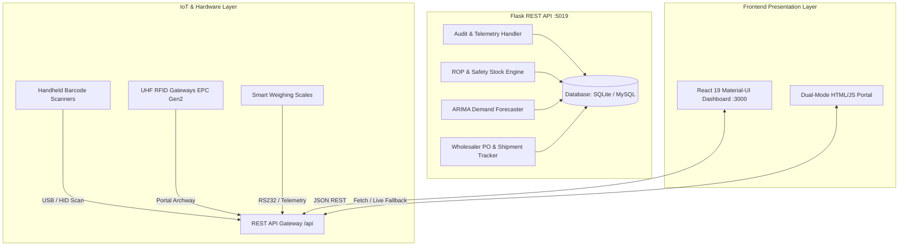

# Project 19: Stock Management & Predictive Inventory System (SMS)

| Attribute | Details |
|---|---|
| **Project Identifier** | Project 19 of 55 |
| **Domain** | IoT & Fintech Supply Chain Engineering |
| **Directory** | `project_19_stock_management` |
| **Backend Port** | `http://localhost:5019` (Flask REST API + SQLite/MySQL Engine) |
| **Frontend Options** | Full React Material-UI Dashboard (`http://localhost:3000`) & Standalone Portal (`frontend/index.html`) |

---

## 📄 Abstract
This work is aimed at developing a hardware-based system named **Stock Management System (SMS)** for managing the stock operations of any organization through integrated technological workflows. The system stores detailed product inventories, tracks maintenance and shelf life, dynamically decrements stock upon POS sales, and generates automated daily and weekly sales and valuation reports. The architecture categorizes distinct aspects of direct sales, supplier procurement, and physical inventory auditing. Without disciplined stock control, retail and wholesale enterprises risk crippling stockouts or severe overstock carrying costs. The system actively computes **Reorder Points (ROP)** to alert wholesalers when replenishment orders must be placed, logs **immutable audit movement trails**, tracks **large multi-stage cargo shipments**, and interfaces with **IoT hardware (Barcode Scanners, UHF RFID Archways, and Smart Load-Cell Scales)** to minimize recording discrepancies and eliminate inventory shrinkage.

---

## 🏗️ System Architecture



---

## 📊 Core Mathematical Formulations

### 1. Dynamic Reorder Point (ROP)
$$\text{ROP} = (\bar{d} \times L) + \text{Safety Stock}$$
Where:
- $\bar{d}$ = Average Daily Sales Demand
- $L$ = Supplier Procurement Lead Time (Days)
- $\text{Safety Stock} = Z \times \sigma_d \times \sqrt{L}$ (at 98.5% Service Level, $Z = 2.17$)

### 2. Economic Order Quantity (EOQ)
$$\text{EOQ} = \sqrt{\frac{2 \times D \times S}{H}}$$
Where:
- $D$ = Annual Demand (units)
- $S$ = Fixed Purchase Order Cost (₹)
- $H$ = Annual Carrying Cost per Unit (₹)

---

## 🔌 Complete REST API Endpoints

| Category | Endpoint | Method | Description |
|---|---|---|---|
| **Health** | `/api/health` | `GET` | Service status, engine version & active DB engine |
| **Dashboard** | `/api/dashboard` | `GET` | Executive metrics, valuation, gross margin, weekly trend |
| **Catalog** | `/api/products` | `GET`, `POST` | List and register catalog SKUs with barcodes and RFID |
| **Product Item** | `/api/products/<id>` | `GET`, `PUT`, `DELETE` | Item details, manual adjustments, delete item |
| **Categories** | `/api/categories` | `GET`, `POST` | Category ledger groups and product counts |
| **POS Sales** | `/api/sales` | `GET`, `POST` | Real-time sale checkout with auto-decrement & audit log |
| **Audit Ledger** | `/api/movements` | `GET` | Inward/Outward movements, device sources, and reasons |
| **Procurement** | `/api/suppliers` | `GET`, `POST` | Wholesaler directory, lead times, ratings, and terms |
| **Purchase Orders**| `/api/purchases` | `GET`, `POST` | Wholesaler PO creation & automatic cargo shipment linking |
| **Receive Cargo** | `/api/purchases/<id>/receive` | `PUT` | One-click PO receiving: increments inventory & updates status |
| **Shipments** | `/api/shipments` | `GET` | Multi-carrier shipment transit tracking & location updates |
| **IoT Devices** | `/api/hardware/devices` | `GET` | Online status, battery %, IP address, and location of devices |
| **Hardware Scan** | `/api/hardware/scan` | `POST` | Process Barcode/RFID scan (Lookup, POS Sale, Inbound Intake) |
| **Load-Cell Telemetry**| `/api/hardware/telemetry` | `POST` | Smart scale unit count calculation & variance detection |
| **AI Forecasting** | `/api/forecast` | `GET` | 7-day ARIMA demand projection & automated ROP alerts |
| **Audit Count** | `/api/audit/reconcile` | `POST` | Physical stock count reconciliation & shrinkage tracking |
| **CSV Exports** | `/api/reports/export?type=...` | `GET` | Instant CSV downloads for products, sales, or movements |

---

## 🚀 Execution Instructions

### Step 1: Start Backend API (Port 5019)
```bash
cd "/Users/balamurugan/Documents/orbyte globel /college project/project_19_stock_management/backend"
source .venv/bin/activate
python3 app.py
```
- Listens on `http://localhost:5019`.
- Automatic fallback: If MySQL is not running on `localhost`, it automatically initializes and seeds a local SQLite database (`stock_management.db`).

### Step 2: Access the Application

#### Option A: Full React Material-UI Dashboard (Port 3000)
```bash
cd "/Users/balamurugan/Documents/orbyte globel /college project/project_19_stock_management/frontend"
npm start
```
- Available at **`http://localhost:3000`**.
- Features 9 modules:
  1. **Executive Dashboard**: Real-time asset valuation, gross profit potential, sales curve, and ROP alerts.
  2. **Products & Inventory**: Searchable inventory table with category filter and CRUD dialogs.
  3. **Sales & POS**: Point-of-sale checkout counter with immediate stock decrement.
  4. **Purchases & Wholesalers**: Enrolled wholesalers, purchase orders, and cargo shipment tracking.
  5. **Hardware & IoT Hub**: Interactive Barcode/RFID laser terminal simulator and smart scale telemetry.
  6. **Demand Forecast & ROP**: 7-day ARIMA demand curves with one-click "Instant Wholesaler PO".
  7. **Category Ledgers**: Multi-tier categorization with share percentages.
  8. **Stock Movements Audit**: Timestamped ledger tracking inward, outward, and audit count adjustments.
  9. **Reports & CSV Export**: Financial summaries, physical count discrepancy reconciliation, and 1-click CSV downloads.

#### Option B: Standalone Interactive HTML Portal
- Open [`frontend/index.html`](frontend/index.html) in any browser.
- Operates in **Dual Mode**: automatically connects to the Python backend when online, and gracefully switches to intelligent client-side simulation when offline.
