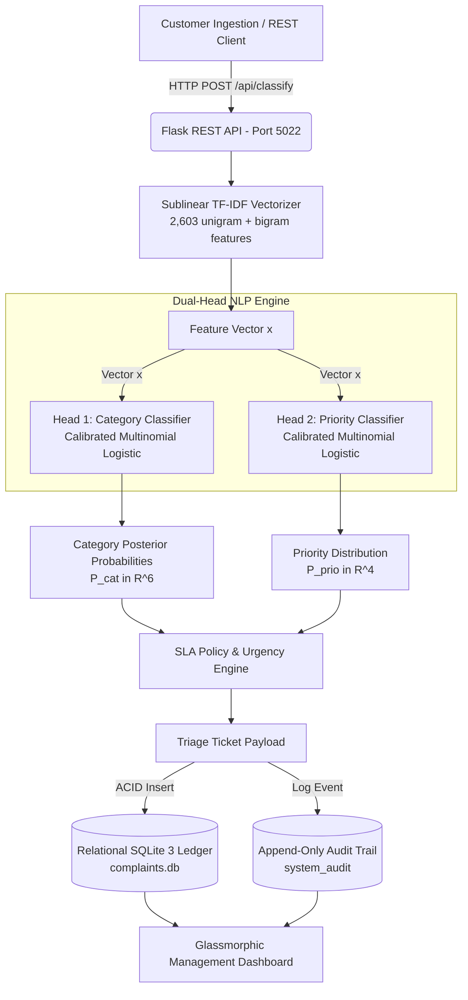

# 03. System Architecture & Topology

## Architecture Diagram (Mermaid)

## Layer Specifications
1. **Presentation Layer:** Semantic HTML5, CSS3 Glassmorphism, Chart.js 4.4, responsive flex/grid layouts.
2. **Application Layer:** Python 3.12, Flask, Flask-CORS, Joblib model deserialization, Scikit-Learn inference.
3. **Machine Learning Pipeline:** `TfidfVectorizer(ngram_range=(1,2), sublinear_tf=True)`, `LogisticRegression(C=2.5, class_weight='balanced')`.
4. **Data Persistence Layer:** SQLite 3 in Write-Ahead Logging (WAL) mode, structured across 4 relational schemas (`complaints`, `departments`, `sla_policies`, `system_audit`).
