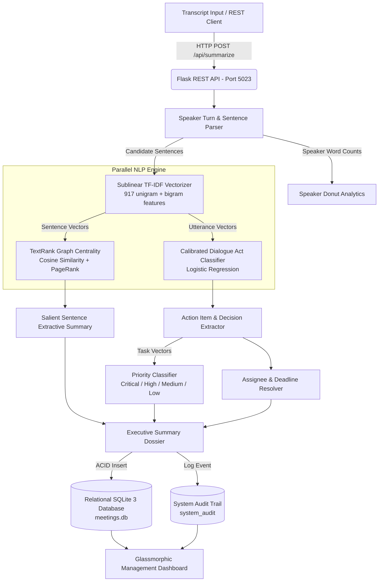

# 03. System Architecture & Topology

## Architecture Diagram (Mermaid)

## Component Architecture
1. **Frontend Cockpit:** HTML5, CSS3 Glassmorphism, Chart.js (Donut & Radar charts), Canvas wave animation.
2. **Backend API:** Python 3.12, Flask, Flask-CORS, Joblib deserializer.
3. **Machine Learning Pipeline:** `TfidfVectorizer(ngram_range=(1,2), sublinear_tf=True)`, `LogisticRegression(C=2.5, class_weight='balanced')`.
4. **Graph Centrality Engine:** Pairwise cosine similarity matrix with 25-cycle power iteration PageRank ($d=0.85$).
5. **Database Storage:** Relational SQLite 3 operating with Write-Ahead Logging (WAL).
