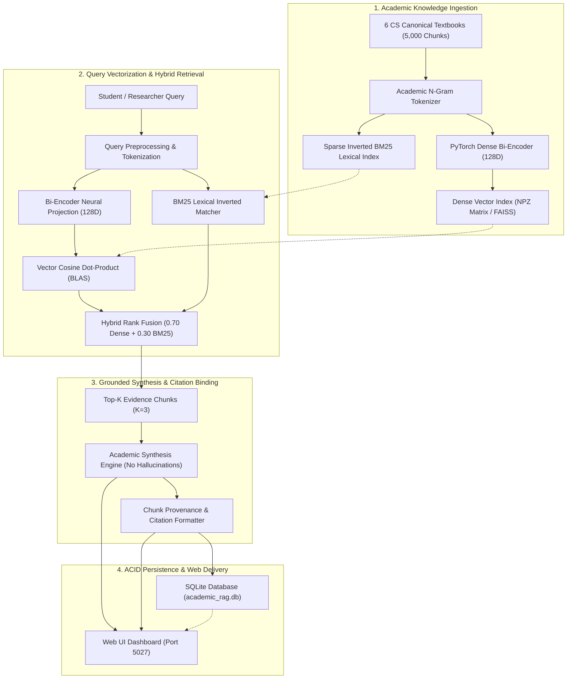

# 03. System Architecture & Topology Design (PROJECT-027)

## Hybrid Scoring Formulation
The retrieval score for chunk $d$ given query $q$ is defined as:
$$S_{	ext{hybrid}}(d, q) = lpha \cdot \cos(\mathbf{e}_q, \mathbf{e}_d) + (1 - lpha) \cdot rac{	ext{BM25}(d, q)}{\max_{d'} 	ext{BM25}(d', q)}$$
where $lpha = 0.70$ balances semantic generalization with keyword precision.
