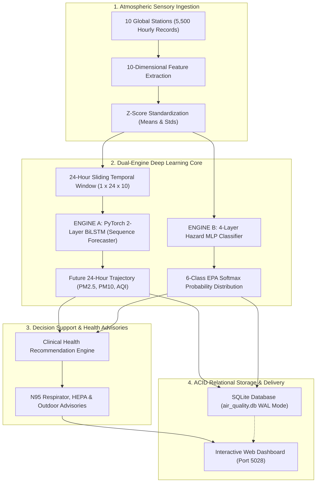

# 03. System Architecture & Topology Design (PROJECT-028)

## Mathematical Formulations
- **Huber Loss Function ($\delta = 10.0$):**
  $$L_\delta(y, \hat{y}) = \begin{cases} 0.5 (y - \hat{y})^2 & \text{for } |y - \hat{y}| \le \delta \\ \delta (|y - \hat{y}| - 0.5 \delta) & \text{otherwise} \end{cases}$$
- **Softmax Hazard Probability:**
  $$P(y = c \mid \mathbf{x}) = \frac{\exp(z_c)}{\sum_{j=1}^6 \exp(z_j)}$$
